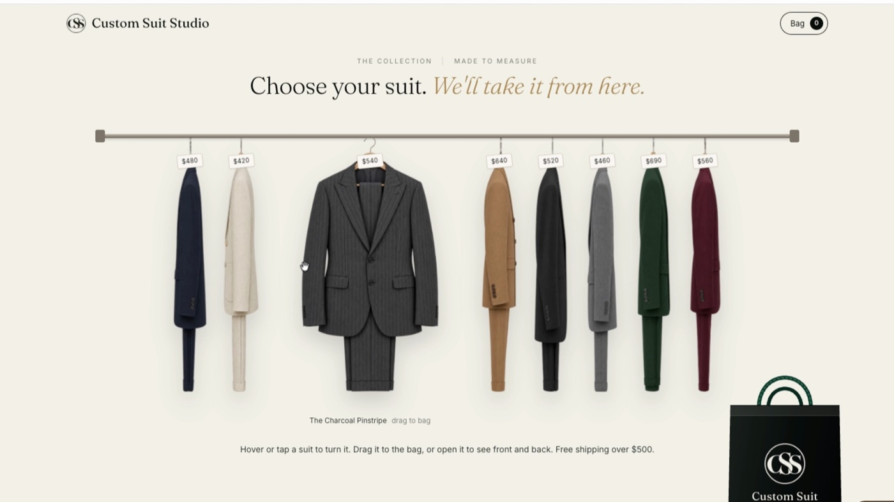
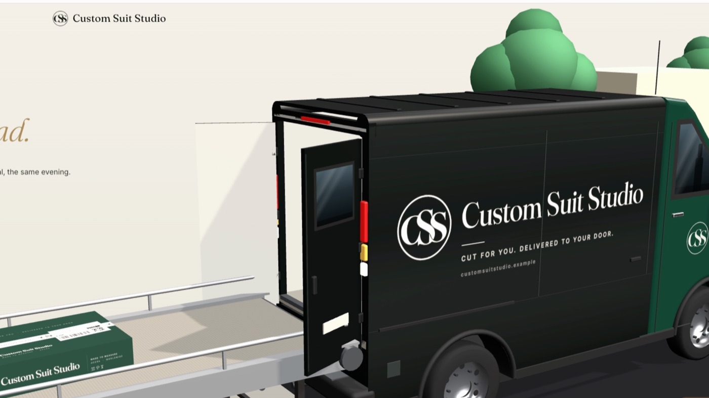

# rail-to-door

A Claude Code skill that builds a complete animated storefront for any brand.

You give it a brand. It gives you a store where:

- products hang side-on on a rail and turn to face you when you hover,
- you drag them into a bag (or a basket, cart or box),
- you check out on a demo payment screen,
- and then a 3D film plays of your order being packed in branded packaging, sent down a conveyor, driven to the airport, flown across a real world map and left on your doorstep.

Every part takes the brand's own name, logo and colours.





See a finished store made with it: [custom-suit-studio](https://github.com/KooEmmanuel/custom-suit-studio).

## Install

Copy the seven skill folders into your Claude Code skills folder:

```bash
git clone https://github.com/KooEmmanuel/rail-to-door.git
cp -R rail-to-door/skills/* ~/.claude/skills/
```

The stage skills read the main skill from `~/.claude/skills/rail-to-door`, so keep that path.

## Use

In Claude Code:

```
/rail-to-door Build a men's made-to-measure suit store called Custom Suit Studio. Dark green and black. Ships from Accra.
```

A one-line prompt works, and so does no prompt at all; the skill decides anything you leave out and tells you what it chose.

You can also run one stage at a time:

| Command | What it does |
|---|---|
| `/rail-to-door` | The whole pipeline |
| `/rail-to-door-brand` | Name, logo, colours, origin city, bag / basket / cart / box |
| `/rail-to-door-products` | Product images with Higgsfield, cut out and catalogued |
| `/rail-to-door-rail` | The shop page: rail, hover-turn, viewer, drag to the bag |
| `/rail-to-door-checkout` | Order drawer, totals, demo payment screen |
| `/rail-to-door-journey` | The 3D film: box, conveyor, van, plane, map, doorstep |
| `/rail-to-door-verify` | Runs the whole flow in a browser and checks every scene |

## What you need

- Claude Code
- Python 3 with Pillow, NumPy, SciPy and OpenCV (for logos and product cut-outs): `pip install pillow numpy scipy opencv-python`
- Optional: the Higgsfield connector, to generate product images. Without it, give the skill your own product photos. It shows the credit cost and waits for your yes before generating anything.

The site itself is plain HTML, CSS and JavaScript with three.js. There is no build step. Run it with `python3 serve.py` inside the generated folder.

The payment screen is a demo; no card details are taken.

## Licence

Apache 2.0. The bundled three.js (r160) is MIT-licensed, © three.js authors. The world map uses Natural Earth data (public domain).
